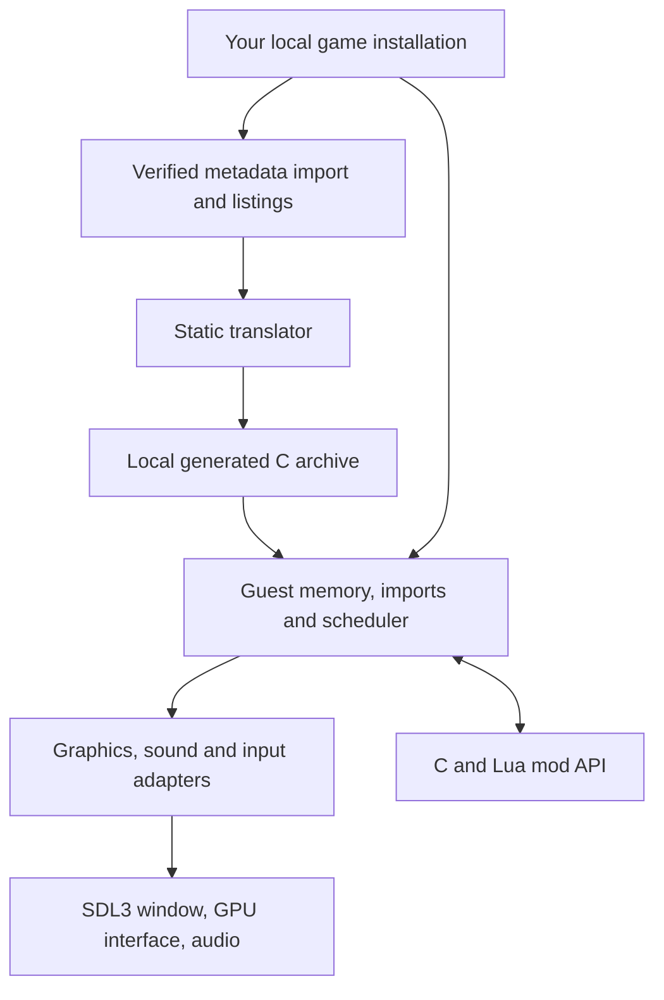

# Architecture

The build translates the supported executable's x86 instructions into C, then
compiles that C alongside a handwritten native runtime. At runtime the executable
supplies the original data image; its machine instructions are not executed by an
x86 emulator. The loader verifies its hash before mapping any of it.

## Guest memory and calls

`runtime/memory.cpp` owns the guest address arena and allocator. Guest pointers
remain 32-bit offsets even in a 64-bit process. `loader.cpp` maps PE sections,
zero-fills data tails and replaces import-table entries with runtime trampolines.
`imports.cpp` decodes calls and dispatches the original calling conventions.

Native platforms reserve the full 4 GiB address range plus a 64 KiB upper
guard, exposing only `[game] guest_size` bytes. Sizes are 64 KiB aligned,
between 256 MiB and 0xffff0000. The heap ceiling, stack, TEB, shims, callback
sentinel and mod heap derive from the available runtime range; mod allocations stop below the
eight-megabyte guest stack. Debug builds compile low-page checks into memory
helpers; `RECOMP_NULL_FAULTS=1` arms the guest access violation. wasm32 retains
a plain allocation because it cannot reserve the full native address range.

`runtime/x86.h` defines the register file, flags, x87 state and
instruction helpers used by generated functions. Functions retain stable guest
addresses for dispatch, hooks and diagnostics. Those addresses are identifiers,
not host pointers and not evidence of human-recovered intent.

A game that ships part of its code as a DLL can name it in game.toml as an
auxiliary module (`[modules.aux.<key>]`). The loader maps it beside the image
at a configured, validated load base below the heap or above all runtime
allocations. `[game] guest_size` can grow the arena to cover high DLLs.
`GUEST_LAYOUT_END` caps the runtime regions at the lowest high DLL base, so
the heap, mod heap, stacks, TEB and shims cannot collide with those images.
Without a high DLL the layout still derives from the full arena size.
The translator turns the module into its own
generated library with prefixed tables that register with the runtime at
start-up; `recomp_call` and `recomp_jump` consult that registry after the
image's own table misses, so calls in either direction cross the boundary
without a special case. `LoadLibrary` of the module's name returns its base
and `GetProcAddress` reads its export directory, which is all the game sees.

Guest mutations require the profile overlay, which boot installs even when
mods are disabled. Without it, all create/write/delete/rename requests fail.
Reads from an installation or overlay layer must resolve canonically within
that root, rejecting symlinks or junctions that escape it. Profile mutations
also reject symlink components. User mods have no default root:
`RECOMP_MODS_DIR` must explicitly name an absolute path. Core resource mods
retain their packaged location.

Environment-selected host code (`RECOMP_EXTRA_CODE`, `RECOMP_VULKAN_LIBRARY`)
is available only in a build configured with `-DRECOMP_DEV_LOADERS=ON`; the
default is OFF. macOS packages use hardened-runtime signing with only the
`disable-library-validation` entitlement for replaceable media libraries.
The web launcher and player load scripts/styles from files under a strict
same-origin CSP. URL environment switches use an exact allowlist, empty by
default (`web/player/env.mjs`), preserving the assigned profile path.

## Threads and ownership

Original game threads are cooperatively scheduled by `runtime/kernel32.cpp`.
Each has a register file and stack, but **one guest thread holds the execution
baton at a time**. A blocking import yields it. Host workers never mutate guest
memory concurrently with that thread.

The presentation worker consumes completed immutable frames. GPU resources and
texture revisions remain alive until commands that reference them complete.
Audio queues use their own clock and synchronization. Window events publish
requests for the guest thread rather than directly executing guest functions.

## A frame through the host

1. The original game submits DirectDraw/Direct3D operations to `dx/`.
2. `host/d3d_render.cpp` translates draws and texture revisions into GPU commands over `host/gpu/gpu.h`.
3. `host/ui_layer.cpp` extracts UI elements from recorded blits.
4. `host/present_thread.cpp` seals the frame, retains its resources and queues it.
5. `host/compositor.cpp` combines world, UI and overlays for presentation.
6. Completion acknowledgements release resources and update frame-pacing samples.

Classic renders at the selected game resolution and aspect-fits the image.
Enhanced can render the world at drawable resolution with separately scaled UI.
Wide view expands the world only when the drawable is wider than the selected
game canvas. The game's own docs (populous-recomp's `docs/DISPLAY.md`) describe the visible behavior.

Direct3D 9 shader objects keep one immutable bounded bytecode copy. Pipeline
bindings share it and retain the shader. External shader references retain
their device; a binding alone does not retain it back, avoiding a cycle.
The device's stored creation parameters remain available through its COM ABI.
Per-stream frequencies travel with each GPU draw. CPU vertex fetch reads
streams 0-7 and selects instance rows by the stream's divider. Metal uses
per-instance layouts and step rates. Core Vulkan/WebGPU use instance-rate
bindings for divider one and skip unsupported larger dividers explicitly.
Metal maps SM3 vPos to pixel coordinates minus the half-pixel offset and
vFace to +/-1. GLSL/WGSL reject those misc registers; screen derivatives are
generated for each language, with Metal/Vulkan readback coverage. Targets
below 64 rows cannot establish or overwrite the render-scale base.

## Timing, input and settings

The render limit and animation clock are separate from the simulation clock.
Increasing the presentation limit must not advance game logic or animations faster.
`mods/animation_timing.cpp` redirects only reviewed visual clock reads.

`host/input_gate.cpp` maps window coordinates through the published frame layout,
corrects the original relative cursor, and handles edge scrolling and focus.
`host/controls/` holds the on-screen controls: a layout model and hit test, a
router that owns each finger, a virtual pad that on-screen and physical
controllers both write to, a binding stage that turns the pad into keys and
mouse (or, in `native` mode, into the DirectInput joystick and XInput devices
in `dx/`), the overlay that draws it and the on-device editor. Everything but
the overlay and the SDL glue is SDL-free and unit-tested in `controls_tests`.
See `docs/superpowers/specs/2026-09-17-touch-controls-design.md`.
For native pad mode, `[controls.native] attached_only = true` makes DirectInput
enumeration and XInput availability follow the physical controller connection.
The default is false, preserving the always-present virtual pad. Connection
state is published through the virtual pad's mutex; guest polling never calls
SDL. A smoke script that uses a pad marks its simulated controller attached.
`mods/options_menu.cpp` extends the original Options page and queues changes at
guest-safe boundaries. `mods/game_settings.cpp` persists original graphics choices;
`mods/settings.cpp` atomically persists host/mod settings in the selected profile.

## Discovery, and code a build does not carry

Translated local back edges share `goto_label`, which emits a budget poll
before backward/self transfers, including computed switch and pushed-return
continuations. Every 4096 taken back edges offers an immediate scheduler
handoff on registered guest threads, except inside atomic stretches. Import
checkpoints retain their time slice. Each guest parks on its own condition;
handoffs wake the new holder, object changes wake a holder parked for work,
and process-wide notifications wake everyone. Thread publication uses the
scheduler mutex. Only the baton holder expires waits or drains queued host
signals after entry; pre-entry setup may drain when workers are stopped.
Waited-on armed timers are deadlines even for INFINITE waits. Helper window
message loops sleep cooperatively without driving host frame services.

Auxiliary DLL `base` is a load address, which may differ from its PE preferred
base. Translator and loader both accept PE32 HIGHLOW relocations and ABSOLUTE
padding, rejecting missing/malformed directories and unsupported or invalid
sites when rebasing. The translator re-decodes listed instruction starts from
relocated bytes, preserving non-pointer constants and relative branch targets.
Ranges start on a 64 KB boundary at or above 0x10000, fit the arena, end below
`heap_base` or start at/above `GUEST_LAYOUT_END`, and cannot overlap another
mapped image. All modules map before any IAT binds.
Mapped imports own dependency references; DLL_PROCESS_ATTACH runs dependencies
first, DLL_PROCESS_DETACH releases them in reverse order, and fresh loads restore
the relocated, bound image. Cyclic back edges do not acquire duplicate lifetime
references. Static EXE imports attach and pin their full dependency graph before
EXE TLS callbacks/entry. Failed startup attach rolls back its acquired graph.

A port whose executable sits below its data root sets `[game] exe_dir`, for
example `"Binaries"` or `"Binaries/Win32"`. It must be relative, with no dot
or parent components, and `developer_exe` must sit in that directory.
Setup links and launcher imports keep the installation root above it.
The runtime receives the EXE's host folder and strips only a complete,
case-insensitive configured suffix, ignoring trailing separators. If it
does not match, both root and EXE paths use the legacy layout. The guest's
initial current directory is its EXE folder, so `..` reaches sibling data;
module filenames, command line and PATH use that folder. PATH then includes
the data root. Full paths normalize dot/parent components without climbing
above a drive root; a trailing separator has no filename component.

Hardware probes use `[system] desktop = "1024x768"` and `memory_mb = 512`
by default. The desktop is shared by USER32, GDI and D3D9 until a selected
display mode takes over. `[d3d9.adapter]` accepts `vendor_id`, `device_id`,
`description` and `video_memory_mb`. Defaults remain the GeForce 7800 GTX
(0x10de/0x0091) and DirectDraw's 32 MB; D3D texture memory has a 256 MB floor.
Memory is reported consistently by the legacy and 64-bit memory structures;
legacy 32-bit totals saturate at UINT32_MAX. D3D9 enumerates 17 X8R8G8B8
modes from 640x480 to 2560x1600 at 60 Hz.

A port can audit its CRT pair and set `[translate] intrinsics` to a table
containing `setjmp` and `longjmp` guest addresses. These replace both CRT
bodies with runtime intrinsics and remove alternate entries inside them.
Direct setjmp calls save the host jump buffer in their caller's live frame;
indirect setjmp calls retain the runtime's explicit failure path. An empty
table disables substitutions, while omitting it retains existing-port defaults.
An executable's pair is cleared when translating an auxiliary module.

Switch recovery keeps clean omitted cases in the dispatching body. A case
may fall into its own listed tail; another body's bytes and opcode interiors
remain boundaries. Distant cases are accepted within the body's own listed
extent. Bounds through EBP locals require a stable frame/slot and an away
guard, with no branch bypassing the comparison. ESP locals are not inferred.
Pointer-named methods probe their own switches before treating relocated
case labels as independent entry candidates.

`RECOMP_TRACE_DISCOVERY=00401000,00402000` logs consideration, ownership and
evidence changes for selected addresses. `tools/recomp/tests/probe_discovery.py
--game games/example` removes configured seeds from an in-memory scratch
configuration and re-runs discovery into `build/probe-discovery`; `--addresses`
selects specific addresses. It never edits the port's files.

A port can deliberately omit code using `[translate] untranslated_ranges`,
an array of `{start = 0x401000, end = 0x402000, on_branch = "fail"}` tables.
The end is exclusive; ranges must not overlap. `fail` (the default) refuses
a direct branch into that range, including under `--allow-unmodelled`.
`trap` emits `recomp_unknown_call` at the transfer. The exclusion applies to
listed and discovered code; executable exclusions are cleared for DLLs.

Multimedia timers default to the guest message pump. A game can select
`[system] mm_timers = "thread"` to run them on a runtime-owned cooperative
worker with its own guest stack and TLS. It waits on an event until the next
deadline, so creating or cancelling a timer wakes it. Frame services remain
on the message-pump path. Periodic timers retain their phase and skip missed
intervals after one catch-up callback. Timer deadlines use the actual pinned
clock when one is active. Hosts stop the worker before driving guest shutdown.

Static discovery is a guess about where code is, and it misses some: a
function only ever reached through a pointer nothing resolves, a jump-table
slot no listing owns, a block Ghidra ended early. Each shows up at run time as
a call or jump the address table cannot place.

`RECOMP_DISCOVERY=<file>` writes those addresses in the form
`tools/recomp/translate.py --discovered` reads back as entry points, so a run
tells the next translation what it missed (`runtime/discovery.h`).
`tools/discover.py` repeats that until a pass finds nothing new. Meanwhile
`runtime/interp.cpp` runs what the translation lacks, so a gap costs speed
rather than correctness.

On the desktop, `tools/lazy_static.py` compiles just the discovered functions
into a library that registers itself with the runtime's module table
(`RECOMP_EXTRA_CODE`), which is the difference between a minute and a full
rebuild. iOS runs no code that was not signed into the app, so there the
addresses go into `game.toml` and the app is rebuilt.

## Current boundaries

The original simulation is generated code, not a hand-rewritten gameplay engine.
It intentionally retains low-level register operations. The handwritten runtime,
adapter APIs, build tools and reviewed extension points are the primary places to
contribute. Generated functions have address/symbol comments and per-instruction
provenance; change the translator or a reviewed replacement, then regenerate.

The desktop app builds on macOS, Linux and Windows; the iOS packager runs
on macOS. `src/core/` contains only shared type headers used by the retained
tests; it is not a second game engine. Capture/replay under `mods/native/`
validates prospective native replacements locally.

Platform services (threads, virtual memory, plugins, files, clocks) go through
`platform/os.h`, with POSIX and Win32 implementations; the build is
CMake with presets per platform (`CMakePresets.json`).
